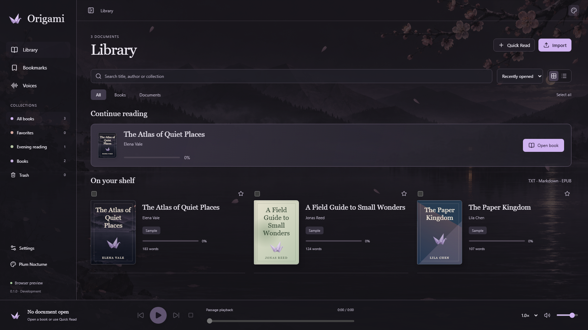

# Origami

A local desktop reader and text-to-speech workspace for Windows and Linux. MIT-licensed source code. This is an early development build, not the completed first release.



## Available now

- Library with search, sorting, collections, favorites, bulk selection and recoverable Trash.
- TXT, UTF-8 Markdown and unprotected text EPUB import. Quick Read for pasted text.
- Reader with chapter navigation, saved narration position, bounded page rendering and adjustable page width, including full width.
- Colored underlines, margin notes, bookmarks, grouping and annotation export.
- Independently collapsible/resizable panels and a contextual tabbed inspector. Library keeps the full workspace without an inspector.
- Twelve app palettes; separate white, paper, sepia and textured night reading surfaces.
- Background opacity control, windblown petals, mountain fog, lake mist and ripples, subtle cabin lights and an occasional cloud across the moon. Each effect can be switched off. Motion defaults on for new settings, respects reduced motion and pauses while hidden.
- Windows desktop SQLite persistence. Browser preview uses separate IndexedDB storage.
- Optional isolated Qwen worker, passage playback, pause, stop, passage seek, speed/volume and one-passage read-ahead.
- Voice catalog with language, voice gender and style filters, accent/name search, favorites and sorting.

No cloud account is required. Voice models and reference recordings are not included. Linux source/build support is provided; Linux execution has not yet been validated on the development machine. See [progress](docs/PROGRESS.md) for exact test status and limitations.

## Development

Use Node 24 or newer, a current stable Rust toolchain and the [Tauri platform prerequisites](https://v2.tauri.app/start/prerequisites/). Windows needs the MSVC build tools and WebView2. Linux requires the documented WebKitGTK and build packages.

```sh
npm ci
npm run desktop:dev
```

For the browser preview:

```sh
npm run dev
```

Open the printed localhost address. Browser preview supports library and annotation workflows; speech generation runs in the desktop app.

## Local speech

See [speech setup](docs/LOCAL-SPEECH.md). The model manager and packaged dependency installation are still planned. Without a configured engine the reader remains usable.

## Checks and builds

```sh
npm test
npm run build
npx playwright install chromium
npm run test:e2e
cargo test --manifest-path src-tauri/Cargo.toml --lib
npm run tauri build -- --no-bundle
```

Windows/Linux CI is defined in .github/workflows/ci.yml. It does not run until the repository is hosted with Actions enabled. The browser checks do not certify Linux WebKitGTK, audio devices, assistive technology or GPU inference.

## Project structure

- src: interface, document normalization, storage adapter and player controller.
- src-tauri: desktop commands, SQLite storage and worker lifecycle.
- workers: versioned, isolated local speech protocol.
- tests and e2e: document, persistence and real UI workflow checks.
- docs: product plan, implementation progress, setup and deferred ideas.

## Roadmap and contributions

Follow the [first-release plan](docs/PRODUCT-PLAN.html). The next work is document fidelity, persistent audio jobs, selected-passage repair, complete audiobook export, model setup and opt-in integrations. Studio, automatic character attribution, voice creation, system sound capture and a richer text editor come later.

Changes should include validation appropriate to the behavior. Maintain platform adapters and preserve local files. Never add personal voice recordings, model weights, tokens or runtime configuration to Git. Keep interface copy direct and descriptive.

## License and assets

App source: [MIT](LICENSE). Dependencies retain their licenses. Model weights, voice references and user documents have separate terms and are not relicensed by this repository. The included sample passages are original demo text with fictional author names. See [asset provenance](docs/ASSETS.md).

The project does not modify or take over an existing Maeve installation.
